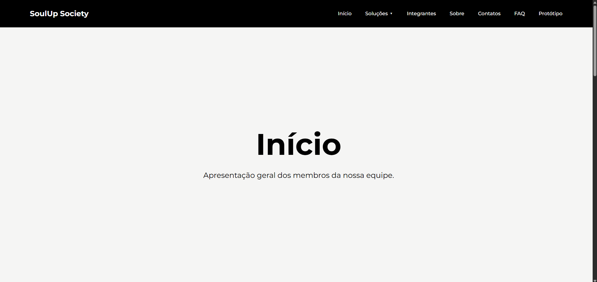
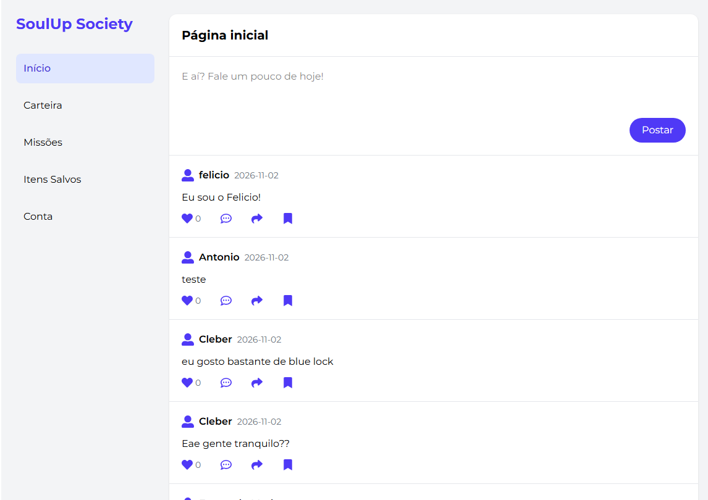
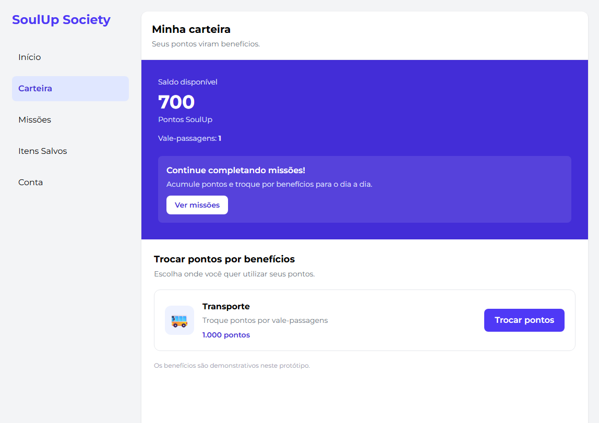

# 🚀 Soul Up Society

## 📌 Descrição do Projeto

O SoulUp Society é uma plataforma que busca incentivar práticas sustentáveis por meio de missões realizadas pelos usuários em troca de pontos.

A plataforma permite que o usuário crie uma conta, faça login, acompanhe o feed da comunidade, publique e comente em postagens, visualize missões e troque seus pontos por benefícios, como vale-passagens.

## 🖼️ Imagens do Projeto








## 🤖 Tecnologias Utilizadas

### Front-end

- React 19
- TypeScript
- Vite
- React Router
- React Hook Form
- React Icons
- Tailwind CSS
- HTML5

### Back-end

- Java
- Spring Boot (API REST)
- JDBC
- Oracle Database
- Docker

### Ferramentas e hospedagem

- Node.js
- Git e GitHub
- Vercel (front-end)
- Render (API)

## 🔗 Como usar

| Recurso | Link |
|---|---|
| 💻 Repositório do Front-end (GitHub) | [Repositório](https://github.com/SoulUp-Society-Trabalhos/1--Challenge-2--semestre) |
| ☕ Repositório da API Java (GitHub) | [Repositório](https://github.com/Brenoell/Challenge-Java-2-Challenge) |
| 🌐 Site publicado (Vercel) | [Acessar site](https://projeto-front-self.vercel.app/) |
| ⚙️ API publicada (Render) | [Acessar API](https://challenge-java-2-challenge.onrender.com) |
| 🎥 Vídeo de apresentação (YouTube) | [Acessar Video](https://youtu.be/1ZaBNqj-5dU) |

> **Observação:** A API pode levar algum tempo para responder devido ao tempo de inicialização do servidor. Aguarde alguns instantes caso a primeira requisição demore.

## 👨‍🎓 Autores e créditos

Breno Elisio Leal Lobato - RM569961

- GitHub: [Brenoell](https://github.com/Brenoell)
- LinkedIn: [Perfil](https://www.linkedin.com/in/breno-elisio-2b123a405/)

Chrisitian Verzellesi Barbuto - RM568677

- GitHub: [ChrisVerBarbuto](https://github.com/ChrisVerBarbuto)
- LinkedIn: [Perfil](https://www.linkedin.com/in/christian-verzellesi-barbuto-938463382/)

Eduardo Pizzoli Junior - RM569529

- GitHub: [dudupizzoli](https://github.com/dudupizzoli)
- LinkedIn: [Perfil](https://www.linkedin.com/in/eduardo-pizzoli-junior-a2964640b)

Eduardo Nery Kurahara - RM570916

- GitHub: [edu64123](https://github.com/edu64123)
- LinkedIn: [Perfil](https://www.linkedin.com/in/eduardo-kurahara-786b003b9)

Gustavo Lizier Pontes - RM573234

- GitHub: [gustavopontes1104](https://github.com/gustavopontes1104)
- LinkedIn: [Perfil](https://www.linkedin.com/in/gustavo-pontes-07aa6a3b3)

## 👾 Link do Repositório Público

[Repositório SoulUp Society](https://github.com/SoulUp-Society-Trabalhos/1--Challenge-2--semestre)

## 📞 Contatos

Breno Elisio Leal Lobato - RM569961

- brenobell03@gmail.com

Chrisitian Verzellesi Barbuto - RM568677

- Chrisvbarbuto@gmail.com

Eduardo Pizzoli Junior - RM569529

- edupizzolijr@gmail.com

Eduardo Nery Kurahara - RM570916

- eduardonerykurahara@gmail.com

Gustavo Lizier Pontes - RM573234

- gulizpon@gmail.com

## 🌲 Organização de pastas

```text

soulup-society/
│
├── .gitignore
├── package-lock.json
├── package.json
├── README.md
│
├── public/
│   └── img/
│       ├── foto-breno.jpg
│       ├── foto-christian.png
│       ├── foto-eduardo.png
│       ├── foto-eduardop.jpg
│       └── foto-gustavo.png
│
└── src/
    │
    ├── components/
    │   ├── Cabecalho.tsx
    │   ├── CardIntegrantes.tsx
    │   ├── Hero.tsx
    │   ├── Newsletter.tsx
    │   └── Rodape.tsx
    │
    ├── routes/
    │   ├── App/
    │   │   ├── AuthPage/
    │   │   ├── Cadastro/
    │   │   ├── Carteira/
    │   │   ├── ContaInfo/
    │   │   ├── Feed/
    │   │   ├── ItensSalvos/
    │   │   ├── Login/
    │   │   ├── Missoes/
    │   │   ├── PostagemDetalhe/
    │   │   └── ProtectedRoute.tsx
    │   │
    │   ├── Contatos/
    │   ├── Error/
    │   ├── Faq/
    │   ├── Home/
    │   ├── Integrantes/
    │   ├── Proposta/
    │   ├── Proposta2/
    │   └── Sobre/
    │
    ├── service/
    │   ├── api.ts
    │   ├── autenticacao.ts
    │   ├── cadastro.ts
    │   ├── carteiras.ts
    │   ├── comentarios.ts
    │   ├── conta.ts
    │   ├── desafios.ts
    │   ├── postagens.ts
    │   └── sessao.ts
    │
    ├── styles/
    │   └── globals.css
    │
    ├── types/
    │   ├── cadastro.ts
    │   ├── carteira.ts
    │   ├── conta.ts
    │   ├── missao.ts
    │   └── postagem.ts
    │
    ├── App.tsx
    └── main.tsx

```

## 🗺️ Rotas do front-end

| Rota | Descrição |
|---|---|
| `/` | Página inicial |
| `/sobre` | Sobre o projeto |
| `/integrantes` | Integrantes do grupo |
| `/faq` | Perguntas frequentes |
| `/contatos` | Formulário de contato |
| `/proposta` e `/proposta2` | Páginas da solução |
| `/app/login` | Login |
| `/app/cadastro` | Cadastro em duas etapas |
| `/app/feed` | Feed de postagens |
| `/app/postagem/:id` | Detalhes de uma postagem e comentários |
| `/app/carteira` | Carteira de pontos e troca por benefícios |
| `/app/missoes` | Lista de missões |
| `/app/salvos` | Itens salvos |
| `/app/conta` | Dados da conta |

## 🚀 Como rodar localmente

Para executar o projeto em sua máquina, é necessário iniciar a **API (Java)** e o **front-end (React)**.

### 1. Clone os repositórios

```bash
git clone https://github.com/SoulUp-Society-Trabalhos/1--Challenge-2--semestre.git

git clone https://github.com/Brenoell/Challenge-Java-2-Challenge.git
```

### 2. Suba a API Java

Configure as variáveis de ambiente para acessar o banco de dados:

| Variável | Descrição |
|---|---|
| `DB_URL` | URL JDBC do banco Oracle |
| `DB_USER` | Usuário do banco |
| `DB_PASSWORD` | Senha do banco |

Depois, execute a classe `SoulupsocietyApplication` ou utilize o comando:

```bash
./mvnw spring-boot:run
```

No Windows, também é possível utilizar:

```bash
mvnw.cmd spring-boot:run
```

A API será iniciada em `http://localhost:8080`.

### 3. Instale e rode o front-end

Entre na pasta do front-end:

```bash
cd soulup-society
```

Instale as dependências:

```bash
npm install
```

Inicie o servidor de desenvolvimento:

```bash
npm run dev
```

### 4. Acesse no navegador

```text
http://localhost:5173
```

O Vite redireciona as chamadas feitas para `/api` ao endereço `http://localhost:8080`, conforme a configuração do `vite.config.ts`. Na Vercel, esse redirecionamento é configurado pelo arquivo `vercel.json`.

> **Observação:** É necessário ter o [Node.js](https://nodejs.org/) e o JDK instalados na máquina para executar o projeto.
